# lizaIP User Guide

A screenshot-illustrated walkthrough: installing lizaIP, setting up your remote's
pages and buttons, the image schemes you can use for icons, and live entity values on
the remote face. For the condensed reference (settings table, troubleshooting,
support), see [`README.md`](https://github.com/liza-home/home-assistant/blob/main/README.md).

## Contents

- [Getting started](#getting-started)
  - [Install](#install)
  - [Scanning / adding devices](#scanning--adding-devices)
  - [Devices and services](#devices-and-services)
  - [Config](#config)
- [What can you do](#what-can-you-do)
  - [Linking to a remote, a page or a button](#linking-to-a-remote-a-page-or-a-button)
  - [Define pages](#define-pages)
  - [Assigning actions to buttons](#assigning-actions-to-buttons)
  - [Let an AI assistant build pages](#let-an-ai-assistant-build-pages)
  - [Config (gear tab)](#config-gear-tab)
  - [Themes](#themes)
  - [Debug (bug tab)](#debug-bug-tab)
  - [Reporting a problem](#reporting-a-problem)
  - [Restoring a configuration](#restoring-a-configuration)
- [How to use mdi, phu, text, media](#how-to-use-mdi-phu-text-media)
  - [Options for a `media:` picture](#options-for-a-media-picture)
  - [Spreading one picture over several buttons](#spreading-one-picture-over-several-buttons)
  - [Combining several things in one picture](#combining-several-things-in-one-picture)
- [How to use variables with examples](#how-to-use-variables-with-examples)
  - [Track names: current, previous, next](#track-names-current-previous-next)
  - [Calculating with variables](#calculating-with-variables)
  - [Using a variable to generate an icon](#using-a-variable-to-generate-an-icon)

---

## Getting started

### Install

Requires Home Assistant 2026.8.0+ with [HACS](https://hacs.xyz). Add the
`liza-home/home-assistant` repository as a custom integration repository, download
**lizaIP**, and restart Home Assistant. Full step-by-step instructions (including the
one-click HACS button) are in the
[Installation section of `README.md`](https://github.com/liza-home/home-assistant/blob/main/README.md#installation).

### Scanning / adding devices

Once the integration is installed and Home Assistant has restarted, a **lizaIP** device
on your network announces itself and Home Assistant discovers it automatically — no
manual IP entry needed. A discovered device shows up as a notification/card under
**Settings → Devices & Services**, the same place any other auto-discovered integration
appears; confirming it adds the device.

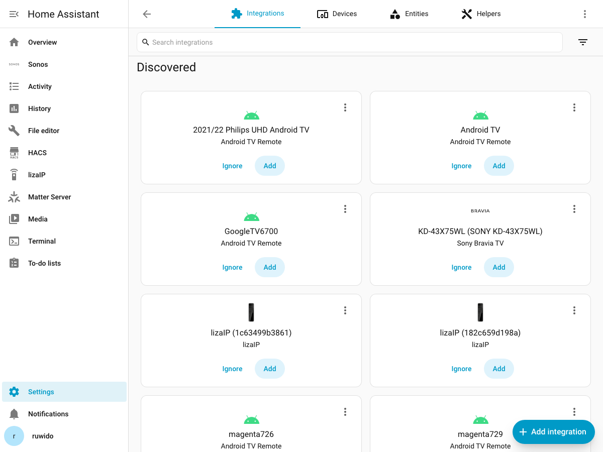

### Devices and services

The device's own page (**Settings → Devices & Services → lizaIP → *device name***) is
where you see everything Home Assistant knows about the remote: its entities, firmware
version, IP address, and recent activity.

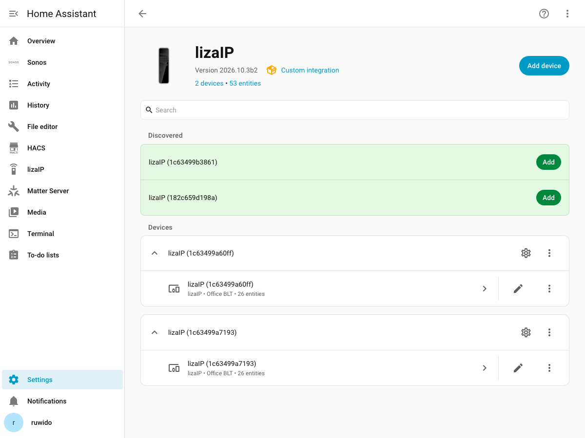

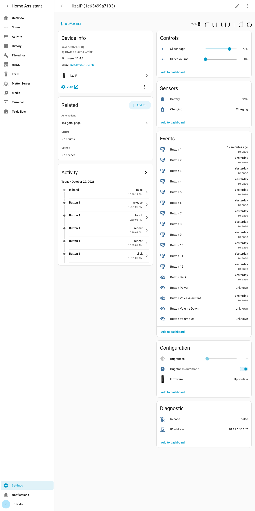

It lists:

- **Controls / Sensors** — one entity per button (for state-based automations), battery
  level, Wi-Fi strength, and similar diagnostics.
- **Configuration** — brightness and automatic-brightness entities, firmware version.
- **Diagnostic** — the device's IP address and connection state.

### Config

Nothing needs to be configured for the remote to work, but **Settings → Devices &
Services → lizaIP → Configure** has a few options worth knowing about: device language,
optimistic updates, the slider update interval, and demo mode. See the
[Settings table in `README.md`](https://github.com/liza-home/home-assistant/blob/main/README.md#settings) for what each one
does.

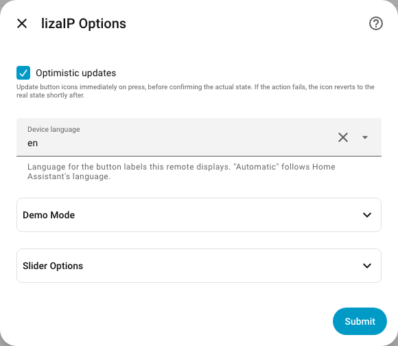

---

## What can you do

Everything below happens in the **lizaIP** panel in the Home Assistant sidebar, which
opens the editor with its four tabs: **🎛️ Buttons**, **⚡ Actions**, **🐞 Debug** and
the gear.

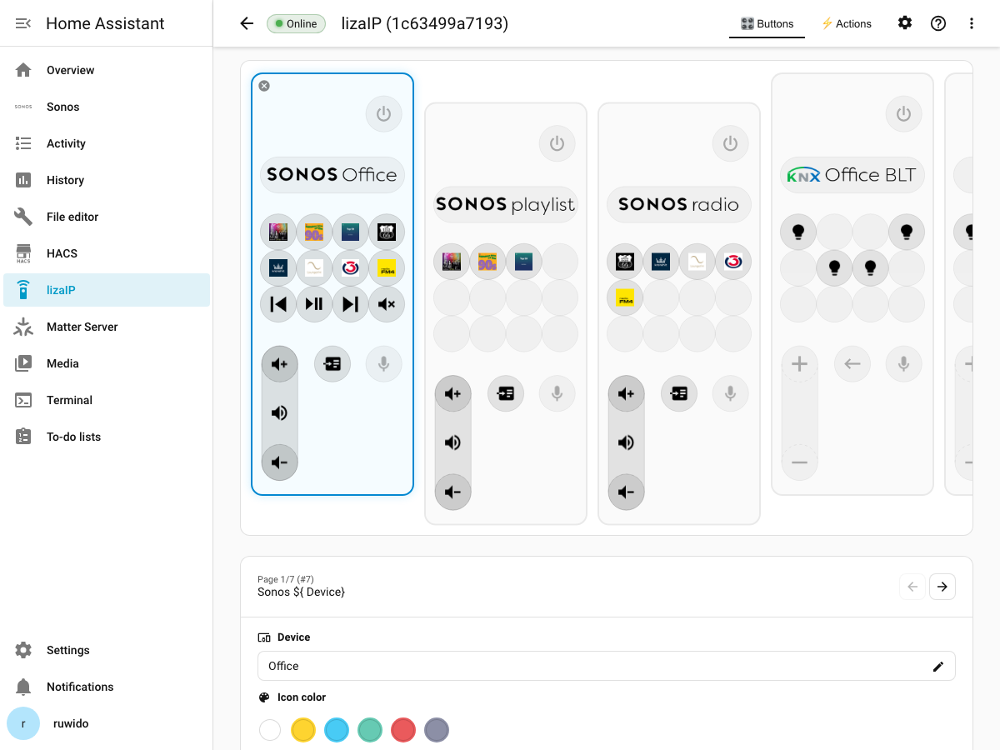

The tabs sit at the right of the toolbar, above the remote face, next to the gear,
the **?** that opens this guide, and the **⋮** menu:

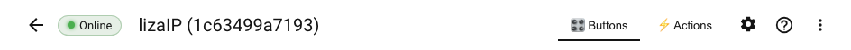

The **?** opens this guide beside the editor, so you can read it while you work. It
searches, remembers where you were, and its pictures open full size when clicked:

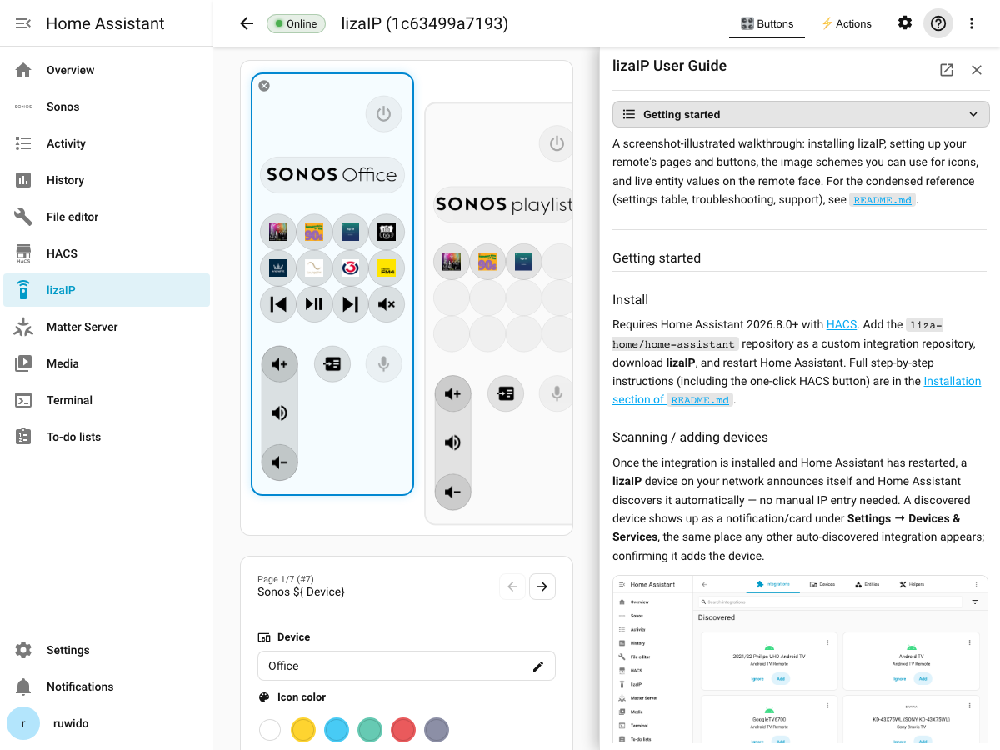

A page holds **12 freely assignable buttons** plus fixed controls (power, back, voice,
volume, and a vertical slider). The strip beside the remote face shows every page —
click a thumbnail to edit it, drag to reorder.

### Linking to a remote, a page or a button

The address bar follows what you have open, so any of it can be bookmarked or
pasted to someone else:

| What you are looking at | URL |
| --- | --- |
| The device list | `/lizaip` |
| One remote | `/lizaip/<id>` |
| A tab of it | `/lizaip/<id>/actions`, `…/settings`, `…/debug` |
| A page | `/lizaip/<id>/buttons/<page_id>` |
| A button on that page | `/lizaip/<id>/buttons/<page_id>/button_3` |

`<id>` is the remote's own short id — the hex in its name, for example
`1c63499a7193` — so you can tell from a link which remote it opens. The long
config-entry id works too, which is what links written by older versions carry,
and capitalisation does not matter either way.

If a link names a remote, page or button that is no longer there, the panel
opens as much of it as still exists rather than failing: an unknown page falls
back to the remote's first page, and an unknown remote to whichever remote you
already had open, or the one you last worked on, or the only one you have. You
land on the device list only when there is genuinely nothing to prefer.

Leaving the panel for another part of Home Assistant and coming back returns
you where you were, including the page and button. Clicking **lizaIP** in the
sidebar while the panel is already open goes back to the device list instead —
that click is how you get out of a remote without hunting for the back arrow.
If you only have one remote paired there is no list to show, so that click
takes you to its pages, cleared of whatever you had selected.

### Define pages

Click the **+** tile at the end of the page strip to add a page: start **blank**, or
pick a **template** — a ready-made page for a device you already have in Home Assistant
(for example, a Sonos speaker with its favourites already laid out). A Sonos page is
titled with the Sonos logo and the speaker's name, and its Previous, Play/Pause and
Next buttons show the previous, current and next track as their tooltips (see
[Track names](#track-names-current-previous-next)).

> A page **template** here is a ready-made page. It has nothing to do with Home
> Assistant's **template helpers** (the Jinja sensors further down this guide), which
> share the word.

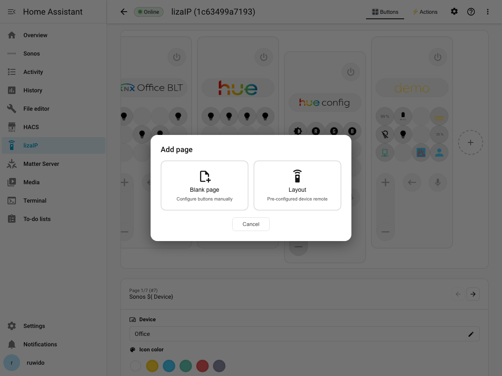

The templates on offer, and the Home Assistant integration each one needs — a template
only lists devices of its integration. Templates for the same device family share one
card: the four Sonos templates are behind a single **Sonos** card, which opens them.
Those cards come from folders under `assets/templates/`, and they nest as
deeply as the folders do.

| Template | For | What the page holds |
|---|---|---|
| **Sonos** | Sonos | Your favourites on buttons 1–8; Previous, Play/Pause, Next and Mute on 9–12; volume |
| **Sonos Radio** | Sonos | Only your favourite radio stations, on buttons 1–12; volume |
| **Sonos Playlists** | Sonos | Only your favourite playlists, on buttons 1–12; volume |
| **Sonos Cover** | Sonos | The album art of what is playing across buttons 1–3, 5–7 and 9–11; Previous, Play/Pause and Next on 4, 8 and 12; volume |
| **Philips Hue** | Hue | Every lamp on a bridge, one per button |
| **Android TV** | Android TV Remote | Remote-control buttons for the TV |
| **Apple TV** | Apple TV | Remote-control buttons for the Apple TV |
| **Amazon Fire TV** | Android Debug Bridge | Remote-control buttons for a Fire TV or Fire TV Stick |
| **Roku** | Roku | Remote-control buttons for a Roku player or Roku TV |
| **Samsung TV** | Samsung Smart TV | Remote-control buttons for the TV |
| **LG webOS TV** | LG webOS TV | The TV's remote keys, transport and volume; Power toggles it (turning it on needs a Wake-on-LAN automation) |
| **Overview** | — (needs no device) | A button for each of this remote's pages, on buttons 1–12 |

A template is only offered while Home Assistant has a device it can be bound to — without
a Sonos speaker, the Sonos templates are simply not in the list.

**Overview** is a table of contents for the remote: each of buttons 1–12 goes to one of
its pages, in the order the pages have, and shows the picture from that page's title (its
logo or icon) — or, for a title of words alone, a short text of the page's name. Subpages
are not listed. It keeps up by itself: add, remove or rename a page and the overview
follows; moving pages around does not reorder it until the next page is added, removed
or renamed. Delete one of its buttons and it stays empty — the overview leaves that
button alone from then on.

**Showcase** sits beside Template in the same dialog: pages that show off what a tile can
do with [variables](#how-to-use-variables-with-examples) and
[pictures](#how-to-use-mdi-phu-text-media). Add one, then open any button to see how it
is written, and copy what you like.

| Showcase | For | What it shows |
|---|---|---|
| **This remote** | nothing — added straight away | The remote's own battery as a value, a fill level, an icon picked by arithmetic and a history graph; whether it is charging or in a hand; its address and firmware |
| **Weather** | nothing — added straight away | Home Assistant's weather as its icon, in words, in °C and °F; humidity and cloud cover as fill levels; wind, pressure — no template helpers |
| **Picture lab** | nothing — added straight away | Logos, tints, backgrounds, the state colours, fill levels and combined pictures side by side |
| **Light studio** | a lamp from Hue, HomeKit or Nanoleaf | Live brightness and colour temperature, brightness presets drawn as fill levels, tinted colour-temperature presets, the lamp's model and firmware |
| **Media wall** | Sonos | The cover over a 2×2 block, volume and track progress as fill levels, the artist as words, previous and next track names |

A showcase that needs no device looks up what it shows when you add it — this remote's
own sensors, the first weather service — and writes those into its tiles; something your
home does not have leaves its tile empty.
After that the tiles are ordinary values — point one at another sensor in its Image field.

The favourites on the Sonos pages stay live: rename or reorder one in the Sonos app and
the buttons follow. On **Sonos Cover** the nine tiles are a picture, not buttons —
pressing one does nothing, and the picture changes with the track (see
[Spreading one picture over several buttons](#spreading-one-picture-over-several-buttons)
for how it is cut). Every template page is an ordinary page once added: change any button
as you like.

Right-click (or long-press) a page in the strip for its menu: **Make subpage** (or
**Make main page**), **Assign device…** for a page that has no device yet — or
**Change device…** for one that has — then **Duplicate** and **Delete**.

**Assign device…** gives a page you built yourself a device, as a template page has
one. The dialog offers every device and proposes the one most of the page's buttons
already control. From then on `${_device}` and `${_device.…}` in the page's title and
buttons read that device, the page card names it, and **Change device…** moves the
page to another device: buttons aimed at the old device's entities are pointed at the
new device's, everything else stays as it is.

With no button selected, the card for that page shows **Page settings** — its
**title**, and the page's device if it has one. Click the title to open its own editor: plain text, an
`mdi:` icon, a `logo:` name, or an image URL (see
[How to use mdi, phu, text, media](#how-to-use-mdi-phu-text-media) below).


### Assigning actions to buttons

Click any button on the remote face to select it. The card below shows that button's
**Image** and **Tooltip** fields, and the action it performs.

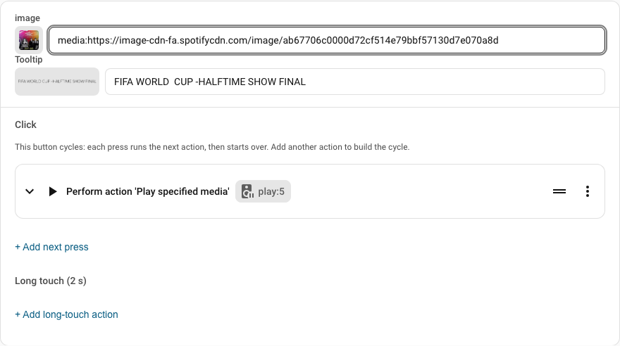

Before you click anything, you can also just **point at a button** — rest the mouse on
a shape on the open page (or tab to it with the keyboard) and a small card appears
beside it summarising that button: its label and icon, every press it runs (a toggle
cycle is listed in the order it cycles — the first four, then a count of the rest),
its long touch, what entity it acts on, and
which page it opens. A button that opens a page that no longer exists says so, which
is worth knowing because the remote ignores such a press. A button with nothing on it
simply says *No action assigned*. Move away or press <kbd>Esc</kbd> to dismiss it.

Sliders get the same card, worded for what they are: it says whether the slider
follows the selected button or is fixed to one device, and names that device and
the property it moves.

- **Image** — what the button shows: an `mdi:` icon, a `logo:`, static `text:`, or a
  live `media:` thumbnail. See [the image schemes section](#how-to-use-mdi-phu-text-media).
- **Tooltip** — what is shown on long-press / hover, and what screen readers announce.
  Usually words, but it takes every image scheme the Image field does (an `mdi:`
  icon, a `logo:`, …).
  It can reference a live entity value, as this screenshot's hint line shows
  (`Now reads **goto page: subpage**`) — see
  [How to use variables](#how-to-use-variables-with-examples).
  A tooltip is shown as it is written, with nothing put in front of it: if it is
  only placeholders and they read as nothing right now, the tooltip is empty. Left
  empty, a button's tooltip is worked out for you from what it does ("Mute", "Off",
  "CH+"); a button with nothing to say stays empty.
- Expand the action row to pick what the button does — call any Home Assistant
  service, or a built-in action such as **goto page**.
- **Key repeat** — holding the button runs its action again and again, like
  the arrow keys of a TV remote: after half a second, 30 times a second until you let
  go; a short tap still runs it once. Both numbers are set per remote in the gear tab,
  under **Buttons** (initial delay 100–2000 ms, rate 1–50 per second). Each press waits
  for the one before it, so a device that answers slowly repeats more slowly rather
  than falling behind. The TV templates switch it on for their arrow and volume keys.
  A button with a long touch does not repeat: holding it is its long touch.
- **Add options…** — right-click (or long-press) a button on the face to give it an
  options page: a new, empty subpage right after the current page, which the
  button's **long touch** opens. Fill it like any page. Offered while long touch
  is switched on for the remote (gear tab) and the button has no long touch yet.
  Delete the options page and the long touch goes with it, so the button can be
  given a new one.

Every action you assign is also listed in the **Actions** tab, the library of actions
in use across all buttons and pages:

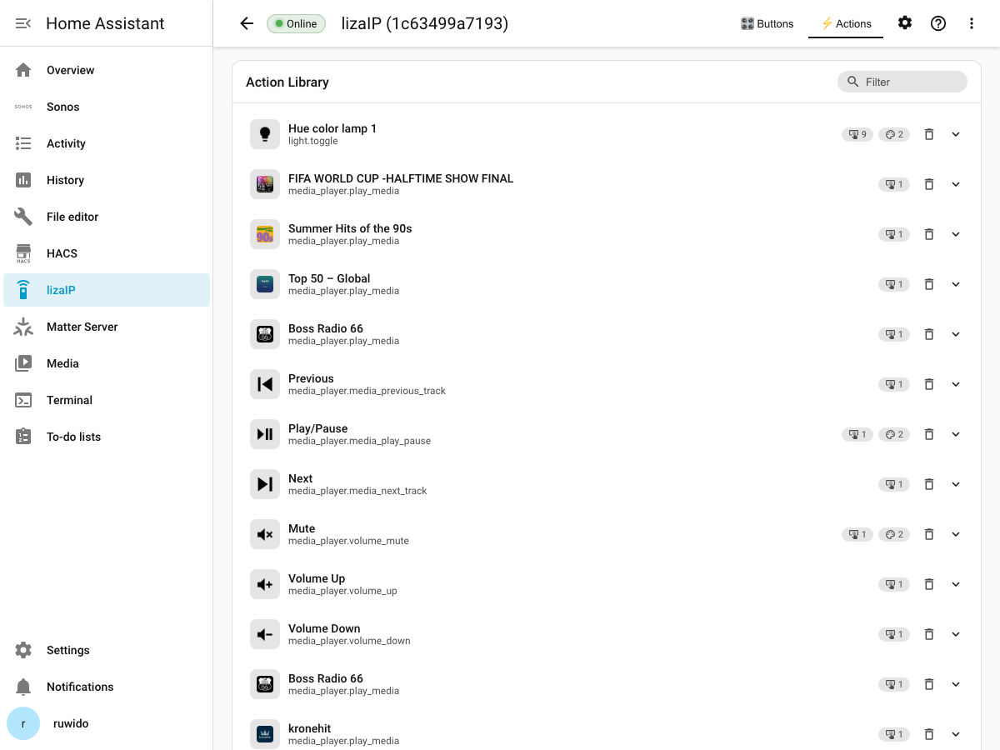

Open a row to rename it (the name tooltips are derived from), set its default icons, or
see every button it's assigned to. This is where you curate actions, not where you
create new ones — new actions are created by assigning them to a button first.

The vertical slider has its own card when selected: pick the entity it drives, what it
controls (brightness, volume, cover position — options depend on what the entity
supports), and a sensitivity.

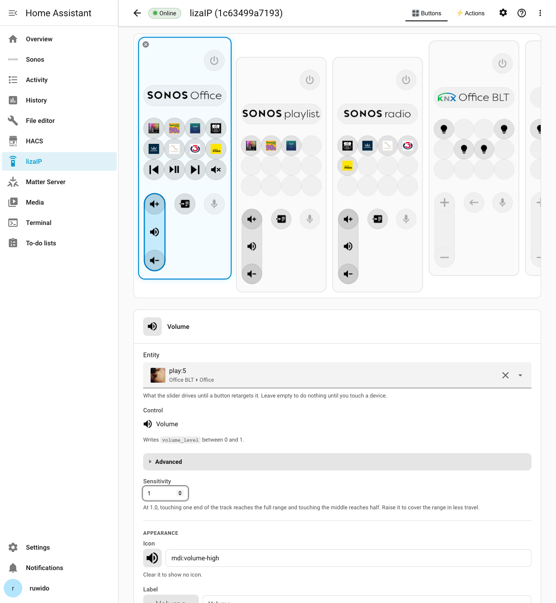

### Let an AI assistant build pages

lizaIP offers its own tools to the AI assistants in Home Assistant, so you can ask for a
page in your own words instead of building it button by button:

- *"Make me a page to control my shades."*
- *"Create a page which lets me control my Sonos in the Wohnzimmer."*
- *"Put the bedroom lamp on button 5 of the Licht page."*
- *"Call button 3 'Kino' and give it the Netflix logo."* — only the tooltip and the
  picture change; the button still does what it did.
- *"Swap buttons 1 and 4"*, *"move the Sonos page to the front"*, *"rename the Licht page
  to Lampen"*.

**Setting it up.** In Home Assistant, open **Settings → Voice assistants**, open the
conversation agent you use (Anthropic Claude, OpenAI, Google, Ollama …), and under
**Control Home Assistant** tick **liza** beside **Assist**. To use Claude Desktop or
Claude Code instead, add Home Assistant's **Model Context Protocol Server** integration and
choose **liza** as its API there.

**What the assistant does.** For a speaker, a TV or Hue lights
it uses the matching [template](#define-pages), bound to the device you named — "in the
Wohnzimmer" picks the speaker in that room. Otherwise it builds an ordinary page button by
button: each button gets an action, the entity it acts on, a short label and an icon, and a
shade or lamp button can steer the vertical slider while it is selected. Either way the page
is added at the end of the remote's pages, as if you had made it yourself, and you can edit
it in the panel like any other.

**What it may not do.** It only sees and uses the entities you exposed to that assistant
(**Settings → Voice assistants → Expose**). Changing a remote needs an administrator account
behind the request. It never changes a page you did not name, and it deletes a page only
when it names both the page's number and its title.

### Config (gear tab)

The gear tab controls the remote's fonts and a couple of button-wide behaviours — page
title and tooltip font/size (with a live preview), and whether buttons support **long
touch** (a second action on press-and-hold).

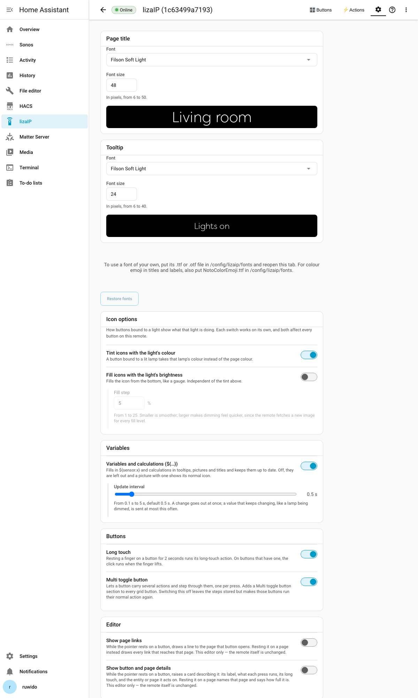

### Themes

A **theme** is one named set of the defaults the remote draws with: the colour
swatches you pick a tint from, the colours an on, off or unavailable button is
drawn in (and the default for one whose state says nothing), the font and size of titles and tooltips, and the default
on/off icons. You pick one per remote at the top of the gear tab's
**Appearance** page.

A theme only replaces what the integration would otherwise decide on its own.
A page's default colour, a button's own picture, colour or font, and the live
colour a lamp's brightness gives its icon all keep winning, so switching a
theme never overwrites a choice you made about a button or a page.

**Default** is built in and is what a remote that has never picked one uses.
Two more presets ship with the integration, and each changes something you
can see before you have coloured a single button: **Monochrome** draws
everything in grey and **High Contrast** uses bolder colours and larger text.

A palette on its own is invisible on a remote whose buttons you have not
coloured by hand, because an ordinary tile is drawn in `on`. A theme
meant to look different therefore sets that, not only its swatches.

#### Picking one

The card offers one row of themes. Each is shown as what it draws — its
colours, its title text at its own size, and its own on/off glyphs — so the
choice is made by looking rather than by reading a name. Click one to try it.

**Result** underneath shows the whole remote under the theme you are trying:
the page title, a row of buttons in each colour, and the tooltip. Every
picture in it is drawn by the integration for this remote, so it is what the
device will show rather than an impression of it.

Nothing is written to the remote while you look. **Apply theme** saves what is
on screen; **Cancel** puts back what the remote has. Both stay greyed out until
you pick something other than the theme the remote already has, and a pick you
never applied is dropped when you leave the page.

A shipped theme is never changed. Each one carries only an eye and a copy
icon: the eye opens it read-only, the copy opens the custom editor with that
theme already loaded, so your changes become a theme of your own and the
original stays as it was. A theme of your own carries a copy icon, a pencil,
a download icon and a bin. The download saves the theme as `<id>.yaml`, the
same file it is kept as.

To add a theme file you were given, drag it onto the dashed **Create…**
tile at the end of the row: it lights up while the file is over it, and the
theme is added as one of your own. It never replaces a theme already there —
a name in use is taken up a number (*Monochrome 2*) — and a file that is not
a theme is refused with the reason. Clicking the tile still opens the editor
on a new theme.

The title and tooltip are the theme's, so there are no per-remote **Page
title** and **Tooltip** cards — there would be nothing to decide. Their fonts
and sizes are set in the theme's own **Text size** section.

#### Reading a theme that came with the integration

A preset shows three of its colours and a line of its text on the tile, which
is enough to pick one but not enough to copy it. Clicking the **eye** on a
preset opens it in the editor headed **View theme — <name>**, with every value
filled in and nothing editable: the palette with its hex codes, the three
state colours, both fonts and sizes, and the on/off icons. The sections still
open and close, so you can read the part you came for.

Nothing there can be saved, because the file ships with the integration and an
update would write over it. **Make a copy I can change** at the bottom hands
straight to the editor on a new theme of your own, started from what you were
reading.

#### Building one of your own

**Create…** at the end of the row opens the editor on a new theme, headed
**New theme** and ending in **Create theme**. It always starts a new file,
whatever the remote is wearing at the time. Make as many as you like. Pointing
at one of yours and clicking the pencil opens the same editor headed
**Edit theme — <name>**, ending in **Save**, so the two are never confused.

**Start from** picks the theme the draft begins as — any of the presets, or
**Blank** to start under no other theme's name. Either way the draft opens on
a full set of colours, sizes and icons, so every field is there to change.
Then name it: the name has to be free, and the editor says so under the field
while it is not.

Underneath are three sections, one per part: **Colours**, **Text size** and
**Icons**. Each opens to the fields that set that part by hand.
Setting one part leaves the other two alone, so a theme can take the colours
it started from and still have sizes of its own.

**Colours** sets two different things, and names them apart.

*Tile colour by state* is the tint a button takes by itself from what the
entity behind it is doing — **On**, **Off**, **Unavailable**, and **Anything
else** for a button with no entity at all.

These are what a button *falls back to*, not the last word. A theme sits below
every choice already made:

    built-in defaults → theme → settings → a page's icon colour
      → the button's own icon colour → the live entity

So a page given an icon colour draws in that colour rather than in the state
colour; an icon written with a colour of its own (`mdi:lightbulb?fg=blue`)
keeps it; and with **Tint icons with the light's colour** switched on, a lit
lamp's own colour wins over all of them. Picking a theme never overrides
something you set by hand — it only replaces what would otherwise be a
constant.

*Colours a page can be given* are the six swatches offered under a page's icon
colour. The caption above each says what colour it now holds, so a swatch
painted red reads **Red**. Behind them the integration keeps six fixed keys —
`white`, `yellow`, `blue`, `green`, `red`, `inactive` — which is what a
hand-written icon asks for, as `mdi:lightbulb?fg=white` does. A theme repaints
a key but never renames it. A page stores the colour it picked, not the key,
so repainting a swatch here leaves pages already set alone.

**Icons** follows the same rule: the glyph is the one a button falls
back to when it names none of its own. An icon set on
the button wins, and an empty field keeps the built-in glyph.

Rather than list every icon the integration knows, the section asks **which
action** you want to change the icons for, and then shows that action's own
icons only. A lamp offers **On** and **Off**; a mute button offers muted and
unmuted; an action that has no states of its own offers the one icon its
domain falls back to. The action is only a way of finding the icon — what the
theme stores is the icon itself, so a theme stays portable between remotes
that have entirely different actions.

Because you are looking through one action at a time, everything the theme
changes is listed under the fields as well, each with a cross to put it back.
That list is the record of what the theme does to icons, whichever action you
happen to be looking through.

**Save** writes it to `config/lizaip/themes/` as a file you can also edit by
hand, and applies it to the remote straight away, so **Result** shows what you
just built. Every remote already drawing with that theme is redrawn with the
edit. A theme of your own can be deleted from the editor or with its bin; the
remotes that were using it fall back to the default look at once.

A remote set up before the picker was simplified may still hold a mix of three
themes. It keeps drawing exactly as it did, and is shown as **Your earlier
mix** so the card tells the truth; its copy icon lifts the mix into a theme of
your own. Picking any theme replaces it.

#### Writing one by hand

Put a `.yaml` file in `config/lizaip/themes/` and restart Home Assistant. The
file name, without the extension, is the theme's id; `name:` is what the picker
shows. Every section is optional — leave one out and that part stays as it is.

```yaml
name: My Theme

colors:
  # The swatches the colour picker offers, in this order. A name of your own
  # invention is re-pointed everywhere, so a button set to `amber` follows the
  # theme; the built-in hues keep their colour so old pages do not change.
  palette:
    - { name: white, hex: "FFFFFF" }
    - { name: amber, hex: "FFB347" }
  # How an on, off or unavailable button is drawn, and `default` for one whose
  # state says nothing (no entity, or an action such as Next track). Quote
  # "on" and "off": YAML reads them bare as true and false.
  states:
    "on": "FFFFFF"
    "off": "8C8FA6"
    unavailable: "964A4C"
    default: "FFFFFF"

text:
  title:   { font: filsonsoft-light, font_size: 48 }
  tooltip: { font: filsonsoft-light, font_size: 24 }

icons:
  # Only the rows you want changed; everything else keeps its usual icon.
  domain_state_icons:
    light:
      "on": mdi:lightbulb-on
      "off": mdi:lightbulb-outline
  domain_icons:
    light: mdi:lightbulb
```

A theme can re-colour a name but never remove one, so a button already set to
a colour your palette leaves out still draws. A font a theme names but that is
not installed falls back to the default font until you add the file, exactly
as it does when you pick one yourself.

#### One colour for the whole remote

To put everything in a single colour, name a `tint:` instead of listing nine
colours:

```yaml
name: Forest
tint: "2ECC71"
```

The tint is what icons draw in, and every other colour name becomes a shade of
it — so a button already set to `blue` joins in rather than staying the one odd
colour on the page. The shades descend in brightness, and *unavailable* is the
dimmest of them: with one hue, a dead button can only be told apart by being
darker than everything else.

Anything you spell out under `colors:` still wins over the tint, so you can
take the ramp and pin one colour by hand:

```yaml
name: Forest
tint: "2ECC71"
colors:
  states:
    unavailable: "EA5A5C"
```

**Always put quotes around a hex colour.** YAML reads an unquoted `859900` as
a number and an unquoted `001122` as octal, and in both cases the colour never
arrives — the built-in one is kept and a warning naming the theme and the
colour is written to the Home Assistant log.

### Debug (bug tab)

The bug tab is where you look when the remote does not answer. **Reachability** pings
it and says whether it came back. **Traffic** counts every message between Home
Assistant and the remote since the panel was opened — how many were asked and
answered, how many timed out or were lost, and how long the round trip took — with
the most recent messages listed underneath, newest first. Nothing here changes the
remote; it only reports.

### Reporting a problem

Every screen of the panel has a **⋮** button — in the toolbar, and on each device in
the list. It offers two downloads and the way back:

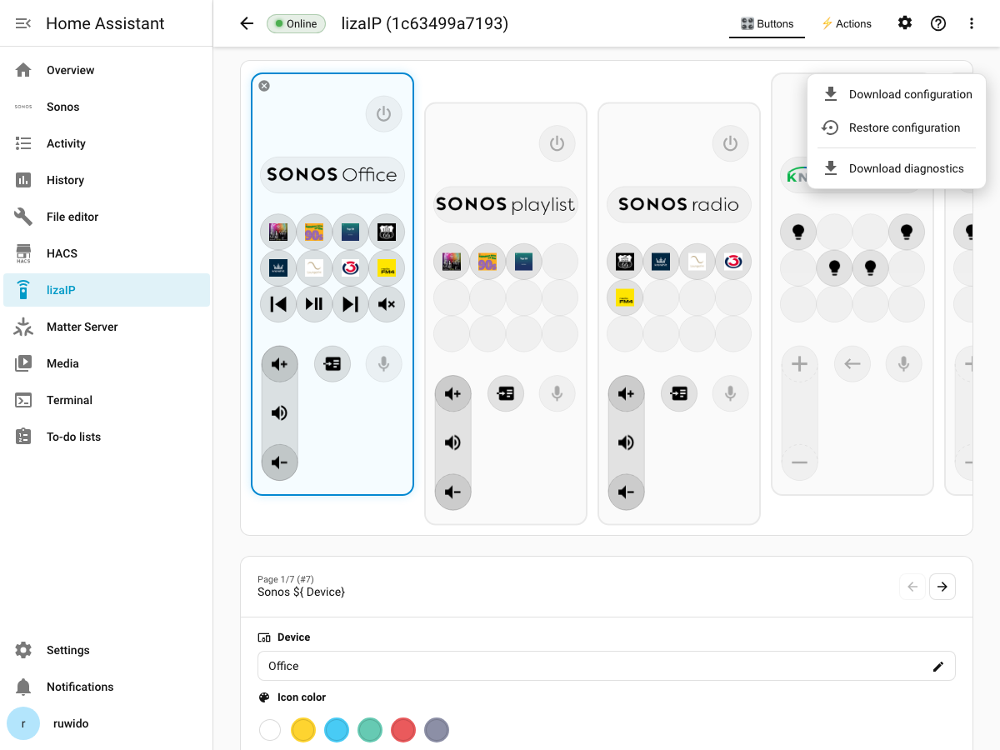

- **Download diagnostics** — everything a bug report needs, in one ZIP you can attach
  to a mail. There is nothing to assemble by hand and nothing to copy out of a log.
- **Download configuration** — a copy of your pages, buttons, action library,
  settings and your own themes, byte for byte as they are stored. No logs, nothing
  about your network, and nothing added: this is the one to keep as a backup, to
  compare against another remote, or to send when the question is about a template.
  It arrives at once, with no window to watch.
- **Restore configuration** — reads such a ZIP back in, so a configuration that was
  lost does not have to be built a second time. See below.

The ⋮ is the only place these live; there is no button in the gear tab.

While diagnostics are being collected, a window lists each part and ticks it off when
it lands, grouped by where it comes from: your configuration, the remote, Home
Assistant, the logs. Collecting takes a few seconds, most of it spent waiting on the
remote — which is why each of its requests is a line of its own, so you can see which
one is being waited on. You can close the window and carry on; collecting continues,
the download still starts on its own, and a small marker in the corner shows how far
it has come and brings the window back when you click it. When the bundle is ready
the download starts and the window closes itself, with a short message naming the
file.

Asking for diagnostics twice does not start a second collection — it brings the
running one's window back, and the ⋮ says how far it has come. A configuration
download can be started at any time, including while diagnostics are still running.

If something goes wrong, the window says what and offers **Try again**. Closing it
puts the matter away and the ⋮ offers the download again as usual. Closing the panel
or reloading the page stops a collection in progress — the bundle would have had
nobody to go to — so start it again when you come back.

The diagnostics ZIP contains:

- the configuration of this remote: its pages, what each button is bound to, and the
  action library — both as it is read and as the YAML files sit on disk;
- every setting that is not a page: the device entry's own data and options, the
  fonts installed, the icon rendering settings, the custom icon sets in use, and the
  model's blueprint and available templates;
- the remote's own report — its read-only endpoints, its log, which modules log at
  which level, and whether its HTTP API answered at all;
- the messages recently exchanged with the remote, including their content;
- the lines from Home Assistant's log that mention lizaip, plus the errors and
  warnings Home Assistant is currently holding;
- this remote's entities with their current state, the versions of Home Assistant,
  the integration and Python, every other custom integration installed, and how long
  this integration took to set up.

The ZIP unpacks into one folder. The four logs sit at the top, next to a
`summary.txt` that answers the first questions in a few lines — which remote, whether
its HTTP API answered, how large the configuration is, which versions are in play and
what could not be collected:

```
lizaip-diagnostics-…/
  summary.txt           the one-page overview
  README.txt            what every file is, and what is in it about your home
  manifest.json         what was collected, and the reason for anything that was not
  log_homeassistant.txt Home Assistant's log, the lines that mention lizaip
  log_device.txt        the remote's own log, as it reports it
  log_messages.json     the messages exchanged with the remote, with their content
  log_errors.json       the errors and warnings Home Assistant is holding
  remote/               the remote's own answers: report, per-endpoint output,
                        reachability and log levels
  homeassistant/        this remote's entities, the versions in play, and the device
                        page's own report
  configuration/        the stored configuration, every setting, and yaml/ — the
                        configuration files exactly as they sit on disk
```

A configuration download is a different shape: a folder named after the device id,
holding only the YAML files. **Restore configuration** reads it back in; dropping that
folder into `<config>/lizaip/` by hand still works as well. There is no README and no
summary — there is nothing to explain.

**Please read before sending.** The bundle names the entities your buttons act on —
your lights, media players and scripts, by their entity ids, both in the configuration
and in the messages exchanged with the remote. That is what makes a button doing the
wrong thing diagnosable, and it is the one part of the file that says anything about
your home. The Home Assistant log inside it is filtered to lines mentioning lizaip, so
other integrations' messages are not included. A `README.txt` inside the ZIP repeats
all of this.

If the remote is offline the download still works: the parts that could not be
collected are listed in `manifest.json` with the reason, and "the remote did not
answer" is frequently the most useful thing in the file.

The device page (**Settings → Devices & Services → lizaIP → *device name* → ⋮ →
Download diagnostics**) has Home Assistant's own diagnostics button as well. That one
produces a JSON file rather than the ZIP. It now carries nearly everything the ZIP
does — the settings, the fonts and icons, the remote's report and log levels, the
errors Home Assistant holds, and the lizaip lines from its log — and it opens with a
`summary` block that says whether the remote was answering and which parts of the file
were shortened to keep it readable in a browser. It is written to be safe to paste in
public: your entity ids are left out of the configuration and blanked out of the log
lines (`light.kitchen_ceiling` appears as `light.***`), and the content of the messages
exchanged with the remote is not included.

Send the ZIP from the panel if you were asked for diagnostics; it is the complete one.
The JSON is the one to attach to a public issue.

### Restoring a configuration

**⋮ → Restore configuration** opens one window that walks the whole job in three
steps — **Choose**, **Check**, **Restore** — named across the top so you can see how
much is left. The first asks for the file: choose it, or drop the ZIP onto the
window, and a bar shows it going up. It is the
one ZIP **Download configuration** saved: a configuration is many YAML files, but
they travel together inside that single archive, so that is all there is to hand
back. Both shapes are accepted: a configuration download, and a full diagnostics
bundle, which carries the same YAML files under `configuration/yaml/`, so a bundle
you sent in is also one you can come back from.

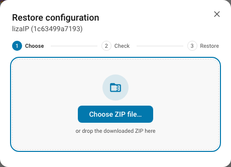

The file is read and checked before anything is touched: it has to be a ZIP, it has
to hold lizaIP's YAML, and every file in it has to parse. If it does not, the window
says why and stays open for another file; nothing has changed. What passes takes you
to the second step: a card with the file's name, the date it was downloaded and how
many pages it holds, and the pages themselves drawn in the order the remote shows
them — the real faces, with the icons of the buttons on them, under the page's
title and its number of buttons. An archive from another remote is taken without
comment: restoring across remotes is allowed, and the pages are simply taken
over. **Back** returns you to the picker, and
nothing has been written until you press **Restore**.

A restore **replaces** — it does not merge. Every page, button and the action library
of that remote are the archive's afterwards; anything created since is gone, and no
copy of it is kept. **Download configuration** first if there is anything in the
current one you may want back.

Themes are the one exception, because they are shared by every remote: the archive's
themes are added beside the device folders, and one you already have under the same
name is left exactly as it is.

Nothing is half-written on the way there. The new configuration is written into a
folder beside the live one and only then moved into place, so a restore that cannot
finish leaves the old configuration where it was rather than a mixture of the two.

The last step holds the window while the files are written and the panel re-reads
them, ticking off each of those two as it passes them, and then says how many pages
came back and waits for you to close it. Closing it puts the keyboard back on the
panel rather than on the ⋮ the window was opened from. The remote is rebuilt in the
background rather than being waited for: pushing a whole configuration back takes a
device round trip per page, and none of it is anything the panel reads, so the
restore is finished on screen while the remote is still catching up on its own.

Afterwards the panel reads the remote from scratch — pages, buttons, thumbnails and
the open editor all come from the restored configuration rather than from what was on
screen a moment ago — and the remote is sent the whole thing anew, so its screen
matches without a restart. If the remote is offline the restore still happens — Home
Assistant holds the configuration either way — and it catches up when it is back.

What a configuration download does **not** carry: the remote's connection settings,
the icon rendering options and the fonts you uploaded. Those belong to the device entry
rather than to the pages, and a restore leaves them exactly as they are.

---

## How to use mdi, phu, text, media

A button's **Image**, its **Tooltip** and a page's **title** are edited the same way
and accept the same values: one plain text box, so anything in it can be copied and
pasted into another field. It accepts one of these schemes:

| Scheme | Shows | Example |
|---|---|---|
| `mdi:<icon-name>` | A [Material Design Icon](https://pictogrammers.com/library/mdi/) | `mdi:lightbulb`, `mdi:page-next` |
| `phu:<icon-name>` | An icon from the [custom-brand-icons](https://github.com/elax46/custom-brand-icons) HACS frontend add-on | `phu:ceiling-fan` |
| `<set>:<icon-name>` | An icon from any other icon set a HACS frontend add-on registered in Home Assistant, e.g. [hass-hue-icons](https://github.com/arallsopp/hass-hue-icons) | `hue:bulb-group` |
| `logo:<name>` | A bundled brand logo, in its native colours | `logo:sonos`, `logo:netflix`, `logo:spotify` |
| `text:<content>` | Plain text, rendered as an image. Plain words need no prefix: `Kitchen` is stored as you typed it and drawn as text | `text:22°C`, `Kitchen` |
| `media:<url-or-path>` | A live thumbnail — album art, a camera snapshot, anything HA can fetch. Takes [options](#options-for-a-media-picture) such as `?size=200x200` | `media:${media_player.living_room.entity_picture}` |
| `http(s)://…`, `/local/…` | A picture from a URL or from Home Assistant's `www` folder | `/local/kitchen.png` |

Editing works the same in all three fields:

- **Enter, or leaving the field, saves it.** Escape undoes the edit.
- **A suggestion list opens once you type an icon prefix** Home Assistant knows —
  `mdi:`, plus any icon set an add-on registered, such as `phu:`. It lists the
  names Home Assistant's own icon picker offers. Click a suggestion, or pick one
  with the arrow keys and Enter, and it is saved straight away. For anything else
  (words, a URL) no list gets in the way.
- **In a title naming several things, the list follows the caret.** Typing
  `logo:hue mdi:li` suggests lightbulbs for the part being typed, and picking one
  replaces only that part and leaves the field open, because a title of several
  parts is not finished by a single pick. Move the caret back into an earlier part
  to complete that one instead. A field holding one thing is still saved
  straight away.

A plain `mdi:` icon, as seen on an actual button here (next to the Sonos pages, this one
uses `mdi:page-next` for "go to the next page"):


Notes:

- **`phu:` needs an add-on.** It only works if `custom-brand-icons` is installed via
  HACS; without it, every `phu:` request falls back to nothing (a blank icon).
- **Icon sets reach the remote through the editor.** Their shapes live in
  the browser (that is where the add-on runs), so the editor hands each one to
  the integration as you save it — `phu:` exactly like `hue:`. A name a
  [variable](#how-to-use-variables-with-examples)
  makes up at run time (`hue:battery-${…}`) is fetched the next time you open
  the editor; until then the remote shows nothing for it.
- **`logo:` has a fixed set:** `disney`, `hue`, `knx`, `netflix`, `prime`, `sonos`,
  `spotify`, `youtube`. Add a colour (`logo:sonos?fg=white`) to render it
  monochrome instead of in its original colours.
- **`text:` always keeps room for accents and tails.** The image is cut to the highest
  any letter of the font can reach (`Ä`) and the lowest (`g`), whether or not the text
  contains such letters, so two short labels of different shape (`Hi` vs `Hg`) stay the
  same height, stand on the same line, and a row of text buttons doesn't jitter.
- **A space puts things next to each other** — `logo:sonos Küche` draws the brand
  mark *and* the room. See
  [Combining several things in one picture](#combining-several-things-in-one-picture).
- **`media:`** is how live thumbnails — a Sonos page's album art, for instance — get
  onto a button; it is usually filled in automatically by a template page rather than
  typed by hand. To scale it or change how it is drawn, see
  [Options for a `media:` picture](#options-for-a-media-picture).

### Options for a `media:` picture

A `media:` picture is drawn as large as fits the field's size (a tile is 50×52), keeping
its own proportions: a square cover in a title stays square. Add options after a `?`,
joined with `&`, like any web address:

```
media:https://cdn-profiles.tunein.com/s8007/images/logoq.png?t=160780&size=200x200
media:${_device.entity_picture}?size=200x200&bg=black
```

| Option | Does | Example |
|---|---|---|
| `size` | Draws the picture at exactly that size, in pixels — stretched to it unless `fit=contain` | `size=200x200`, `size=200` |
| `fit` | `contain` keeps the picture's proportions inside the size, `fill` stretches it to the size. Without a `size` it is `contain`, with one `fill` | `fit=contain` |
| `box` | Answers with one piece of it: `x,y,w,h` of the sized picture | `box=60,62,60,62` |
| `mode` | `dark` (the default) or `light` background rendering | `mode=light` |
| `fg` | Tint colour, for a monochrome picture | `fg=white`, `fg=FF8800` |
| `bg` | Background colour behind the picture | `bg=black` |
| `crop` | `0` keeps the padding around the picture | `crop=0` |
| `alpha` | `1` keeps the picture's transparency | `alpha=1` |
| `percent` | Fill level `0`–`100`: the lower part stays solid, the part above is dimmed | `percent=40` |

These options are taken out of the address before the picture is fetched, so the
picture's own server never sees them. Everything else in the address goes to that server
unchanged (`t=160780` above).

- **A second `?` is fine.** A variable such as `${_device.entity_picture}` usually
  already ends in a query of its own (`…?token=…`). Write `?` anyway; a second one
  counts as `&`.
- **Quotes keep an address exactly as written.** If the picture's server uses one of
  the option names itself — say it takes its own `size=` — put the address in quotes,
  `"…"` or `'…'` (the same at both ends). Everything inside goes to that server; only
  what follows the closing quote is an option:

  ```
  media:'https://host/logo.png?size=2000'?size=200x200&percent=50
  ```

  Here `size=2000` is sent to `host`, and the picture is drawn at 200×200, half filled.
- **`size` takes pixels or a name.** `200x200`, `200`, or one of the sizes the
  remote itself uses: `tile` (50×52), `title` (200×50), `tooltip` (200×40). Anything
  else — `size=large` — is not an option and goes to the picture's server as part of
  the address.
- **A `percent` written here wins** over the fill level the button would show on its
  own (a lamp's brightness, for instance).
- **`box` spreads one picture over several buttons.** See
  [Spreading one picture over several buttons](#spreading-one-picture-over-several-buttons).
- **The options work on any picture, not only `media:`.** `mdi:battery?size=tile`,
  `logo:hue?fg=white`, and the words a variable resolves to:
  `${sensor.kitchen_battery}?size=tile` draws the battery level at tile size. Words
  that merely end in a question mark stay a question — only a `?` followed by at
  least one option is read as one. Anything in that query the remote does not
  know — a typo such as `?size=tile&1rea` — is dropped, and the options beside it
  still apply.
- **Words are made to fit the size asked for.** "91 %" at tile size is drawn
  smaller so all of it shows, rather than running off the side. The lettering is
  only ever made smaller, never bigger, so two tiles beside each other keep the
  same size, and it stops where it would become unreadable. Write a `font_size=` to
  say the size yourself — words wider than their strip are then left wide, which is
  what lets the remote scroll a long page title.

**Colour names.** `fg=` and `bg=` take a 6- or 8-digit hex (`FF8800`, `FF880080`) or one
of these names: `white`, `black`, `yellow`, `blue`, `green`, `red`, `inactive`,
`transparent` — plus four named for a *state* rather than a hue, for tinting a tile by
what the thing behind it is doing:

| You write | Draws | Means |
|---|---|---|
| `fg=on` | plain white | on, running, open |
| `fg=off` | a grey | off, idle, closed |
| `fg=unavailable` | a dimmed red | not answering |
| `fg=default` | plain white | nothing to say: no entity, or an action like Next track |

`on` is simply the default foreground, white: a tile that is on is the normal case,
and a page reads calmer when only the departures from normal carry a hue. `unavailable`
is deliberately duller than `red`: an entity that has gone missing is not an alarm, and
at alarm strength every dead tile shouts louder than the one thing that is actually
wrong. The three are not offered as one-click swatches in the panel's colour picker —
each draws a colour already on offer there — but they are accepted wherever a colour is
typed.

### Spreading one picture over several buttons

One picture can cover a block of buttons: each button carries the same address and
takes a different piece of it. Two options do the work — `size` scales the whole
picture, `box` says which piece to show:

```
media:/local/art.png?size=180x186&box=60,62,60,62
```

`box` is four numbers, `x,y,w,h`: `x,y` is where the piece starts, counted from the
top left of the scaled picture, and `w,h` is how big it is.

**Laying out a grid.** Decide the tile size first, then multiply:

1. A tile on the remote is 60×62. For a 3×3 block, scale the picture to
   3 × 60 = 180 wide and 3 × 62 = 186 high: `?size=180x186`.
2. The tile in column *c*, row *r* (both counted from 0) starts at
   `x = c × 60`, `y = r × 62`.

| | Column 0 | Column 1 | Column 2 |
|---|---|---|---|
| **Row 0** | `box=0,0,60,62` | `box=60,0,60,62` | `box=120,0,60,62` |
| **Row 1** | `box=0,62,60,62` | `box=60,62,60,62` | `box=120,62,60,62` |
| **Row 2** | `box=0,124,60,62` | `box=60,124,60,62` | `box=120,124,60,62` |

The same works for any block — two buttons side by side are `?size=120x62` with
`box=0,0,60,62` and `box=60,0,60,62`.

The **Sonos Cover** template is this grid ready-made: the playing track's cover across
buttons 1–3, 5–7 and 9–11, each tile `${_device.entity_picture}?size=180x186&box=…`.

**Good to know**

- **The piece always comes back in the size the box named.** Where it reaches past
  the picture it is empty rather than short, so a picture whose size does not divide
  evenly still gives a grid that lines up.
- **The piece is never trimmed to what is drawn on it.** A tile that is mostly empty
  keeps its size, so it stays in line with the tiles beside it.
- **A `bg=` fills the piece**, not the picture it was cut from.
- **The pieces are separate pictures to the remote**, each cached under its own
  address — changing one button's box leaves the others alone.
- **It is not only for `media:`.** Any picture takes a box, so `/local/art.png` or a
  variable resolving to an address works the same way.
- **`box` needs four whole numbers.** Anything else is not read as an option, and
  goes to the picture's own server as part of the address.

### Combining several things in one picture

An Image, a tooltip or a page title may name several things separated by spaces; they
are drawn side by side in one picture, in the order written.

| You write | The remote shows |
|---|---|
| `logo:sonos Küche` | the Sonos mark, then the word "Küche" |
| `logo:sonos - Küche`, `logo:sonos + Küche` | the same — a lone `-` or `+` between parts is only for looks and is dropped |
| `mdi:lightbulb Wohnzimmer` | a bulb, then "Wohnzimmer" |
| `logo:hue text:Hue mdi:lightbulb` | the Hue mark, the word "Hue" and a bulb |
| `phu:ceiling-fan text:Fan` | the fan icon, then "Fan" |
| `logo:sonos ${_device}` | the Sonos mark, then the name of the page's device |
| `${_device.entity_picture} + logo:sonos + ${_device.friendly_name}` | the cover now playing, the Sonos mark and the player's name |
| `mdi:thermometer ${sensor.outdoor_temperature}` | a thermometer, then "21.5 °C" |
| `mdi:play mdi:pause` | two icons sharing the space |

**Where a part starts.** A word shaped like a source — `mdi:`, `logo:`, `text:`,
`media:`, `phu:` or any other icon set — always starts a new part. After `logo:` and
`mdi:` (whose names never contain a space) plain words start a `text:` part on their
own, so `logo:sonos Küche` needs no `text:`. After anything else, spell the words out
with `text:`: `phu:ceiling-fan Fan` would be read as one icon named "ceiling-fan Fan",
and a picture — `media:`, an HA path such as `/local/a.png`, or an `http(s)://` address —
ends at the first space (write a space inside an address as `%20`). Words that follow a `text:` part belong to it,
so `text:Living room` is one phrase. A variable is replaced before the picture is
split, so a device name with spaces stays one name.

**How the parts are laid out.**

- **The words always keep room for accents and tails.** A picture with words is as tall
  as the font can reach above and below the line the letters sit on, whether or not
  the name has an `Ä` or a `g`, so titles and buttons line up.
- **Icons and logos stand on that baseline and are as tall as the tallest letter**
  beside them, plus one pixel above and one below so they do not look smaller than the
  letters: next to `Wohnzimmer` a bulb is as tall as the `W`, next to `wasser` only as
  tall as the lower-case letters.
- **Beside a logo or icon the words have a fixed size** (32 px in a page title, or the
  title font size if that is smaller), so a name looks the same next to any mark. A row
  wider than the title bar is simply wider, and the remote scrolls it; only a very long
  name is cut short with `…`. Words on their own still shrink to fit the bar, down to
  32 px.
- **On a square button** a single mark followed by words is stacked instead: the mark
  on top, the words below, shrunk and cut short with `…` to fit the width. Anything
  else — three parts, or the words first — is drawn in a row.
- **Marks without words** (`mdi:play mdi:pause`) share the space evenly and are
  centred.
- **Colour.** The page or button colour applies to the words and to the icons; a
  `logo:` beside other parts keeps its brand colours.

For the full technical reference — query parameters, available fonts, icon tinting —
see the
[Image Server section of the developer README](../README.md#image-server-imgserv).

---

## How to use variables with examples

A button's **Tooltip**, a button's **Image**, and a page **title** can all show the
current value of any Home Assistant entity, by writing its entity ID inside `${…}`:

```
${sensor.outdoor_temperature}        → 21.5 °C   (state, with its unit)
${weather.home.temperature}          → 18        (one attribute, no unit)
${weather.forecast_home}             → Partly cloudy (a weather condition, in your language)
```

**Worked examples**

| Field | You write | The remote shows |
|---|---|---|
| Tooltip | `Outside ${sensor.outdoor_temperature}` | Outside 21.5 °C |
| Tooltip | `Battery ${sensor.lizaip_1c63499a7193_battery}` | Battery 85 % |
| Tooltip | `${media_player.living_room.media_title}` | the song that is playing |
| Image | `text:${weather.home.temperature}°` | 18° |
| Image | `mdi:battery ${sensor.lizaip_1c63499a7193_battery}` | a battery mark beside 85 % |
| Image | `${weather.forecast_home}` | the current weather as an icon (`mdi:weather-partly-cloudy`, …) |
| Tooltip | `Today ${weather.forecast_home}` | Today Partly cloudy |
| Image | `mdi:${sensor.lizaip_battery_icon}` | an icon chosen by a template helper |
| Page title | `Living room ${sensor.living_room_temperature}` | Living room 22 °C |
| Page title (template page) | `${_device}` | the name of the device (or hub) the page is bound to |
| Page title (template page) | `Vol ${round(_device.volume_level * 100)}%` | Vol 12% |
| Tooltip (Sonos template page) | `${_device.media_title_prev}` | Endless Summer — the previous track (see [Track names](#track-names-current-previous-next)) |
| Tooltip (template page) | `${_device} ${round(_device.volume_level * 100)}%` | Living Room TV 12% |
| Tooltip (Hue template page) | `${_device} ${_device.sw_version}` | Hue Bridge 1.56.0 |
| Tooltip (template page) | `${_device} · ${_device.area_name}` | Living Room TV · Living Room |
| Tooltip (page you made yourself, on a play/pause button) | `${_device.media_title}` | the song the button's player is playing |

**On a template page, `${_device}` is always the page's own device.** Whatever page it is written on,
and whichever field — the title, a button's image, its tooltip, an action's icon —
it means the one device that page is bound to: the Sonos speaker, the Android TV,
the Hue bridge. It never means the light a particular button happens to switch.

**On a page you made yourself**, which is bound to nothing, a button's
`${_device…}` means what that button controls: on a play/pause button for the
living-room speaker, `${_device.media_title}` is the song it plays and
`${_device}` the speaker's name. A button that controls nothing reads nothing.

One rule decides where each one is read from: **what only the device knows
comes from the device; everything an entity can answer comes from the
entity.**

These are facts about the device itself — nothing but the device knows them —
and they answer on *every* template page:

| You write | Shows |
|---|---|
| `${_device.area_name}` | the room it is filed under, `Office` |
| `${_device.friendly_name}` | its name, `Living Room` — the same as `${_device}` |
| `${_device.label_names}` | the labels stuck on it, `Favourites, Test` |
| `${_device.manufacturer}` | who made it, `Signify` |
| `${_device.model}` | the model, `BSB002` |
| `${_device.sw_version}` | the firmware it runs, `1.56.0` |

Home Assistant leaves rooms unassigned unless you set them, so
`${_device.area_name}` is often blank. Set one under **Settings → Areas** and
it fills in. Where a single entity is filed somewhere other than its device,
the entity's room wins.

A **room is also where a zone from your lights lands**: a Hue room or zone is
imported by Home Assistant as an area, so `${_device.area_name}` is what names
it. A Sonos zone is the speaker itself, so that is `${_device}`. A Home
Assistant **zone** is a different thing again — a circle drawn on a map, which
a phone moves in and out of — and nothing a remote page is bound to can be in
one, so there is no token for it.

`${_device.label_names}` reads the labels you set under **Settings → Areas,
labels & zones → Labels**. Several are listed alphabetically, separated by
commas. A label on the entity itself wins over one on its device. It is
plural, and spelled apart from Home Assistant's own `label_name`, which takes
one label and gives back its name.

Everything else — `${_device.volume_level}`, `${_device.source}`,
`${_device.media_title}` — is an **attribute of the page's entity**. A page bound
to a hub has no entity of its own (a bridge is not a thing with a state), so
attributes stay blank there while the facts above still answer: on a Hue page
`${_device}` names the bridge and `${_device.sw_version}` gives its firmware.

Type `${_device.` in any of these fields and the editor lists them with
what each one says beside it, so you can see that `model` is `BSB002` before
you pick it. They are listed alphabetically. A fact the integration never
filled in is listed with nothing beside it — which is what it will draw.

### The name

`${_device}` is the name of the device the page is bound to. It reads the same
on every page — a Sonos page, a Hue page, any other — so the same thing
written on two pages answers the same way.

`${_device.friendly_name}` is the same name written out in full, and is
offered in the list of facts above beside the room and the model. Use
whichever reads better: `${_device}` where the line is already crowded,
`${_device.friendly_name}` where it sits next to its neighbours and you want
to see at a glance what it is.

| You write | Reads | On a Sonos page |
|---|---|---|
| `${_device}` | the device's name | Living Room |
| `${_device.friendly_name}` | the same, written out | Living Room |
| `${media_player.kueche.friendly_name}` | that entity's own name | Living Room Media Player |

An entity can be named differently from its device — rename the player alone
and the two part ways. When you want the entity's name rather than the
device's, name the entity in full, as the last row does.

The device's name is the one the user gave it, then the integration's. A hub
whose bridge cannot be found falls back to its config entry's title, which is
a label over the integration and often carries a serial (`Hue Bridge
ecb5fa2ae5d6`).

> Either way the name is the page's own. To name some *other* entity, write it
> out in full: `${media_player.kitchen.friendly_name}`.

### Track names: current, previous, next

On a page built around a media player (a template page such as Sonos), these name the
tracks. Type `${_device.` in a tooltip and the editor offers them.

| You write | Shows |
|---|---|
| `${_device.media_title}` / `${_device.media_artist}` | the track playing now, its artist |
| `${_device.media_title_prev}` / `${_device.media_artist_prev}` | the track before it (where **Previous** goes) |
| `${_device.media_title_next}` / `${_device.media_artist_next}` | the track after it (where **Next** goes) |
| `${_state} - ${_device.media_title}` | Pause - Bohemian Rhapsody |

- **Previous and next are Sonos only** — no other kind of player tells Home Assistant
  what is in its queue. For each Sonos speaker a button or template page points at,
  lizaIP keeps a sensor named after it, `sensor.<speaker>_queue` (for
  `media_player.kitchen`: `sensor.kitchen_queue`), with `next_song`, `next_artist`,
  `prev_song` and `prev_artist`. You can use it anywhere, like any sensor:
  `${sensor.kitchen_queue.next_song}`.
- **On any page**, `${_queue.next_song}`, `${_queue.next_artist}`, `${_queue.prev_song}`
  and `${_queue.prev_artist}` read the queue of the speaker the *button* points at,
  rather than the page's player.
- **Empty rather than wrong.** With shuffle on, on radio or line-in, or at either end of
  a queue that does not repeat, there is nothing honest to name, and the value is
  empty — and so is a tooltip that holds nothing else. With **repeat one**, the next
  track is the one playing.

### Calculating with variables

Inside `${…}` you can calculate with numbers and variables. The result is a plain
number, without a unit, so you add the unit yourself:

| You write | Reads (for the values shown) | What it does |
|---|---|---|
| `${sensor.power / 1000} kW` | 1.25 kW (power 1250) | divide |
| `${sensor.outdoor_temperature * 9 / 5 + 32} °F` | 70.7 °F (21.5) | `* / %` before `+ -`, as usual |
| `${(sensor.a + sensor.b) / 2}` | 20.5 (19 and 22) | brackets |
| `${sensor.minutes % 60}` | 15 (75 minutes) | `%` is the remainder of a division |
| `${-sensor.offset}` | -3 (3) | a leading minus |
| `${round(sensor.outdoor_temperature)}°` | 22° (21.5) | round to a whole number |
| `${round(sensor.outdoor_temperature, 1)}` | 21.8 (21.75) | round to 1 decimal (0–6) |
| `${min(sensor.x, 100)}`, `${max(sensor.x, 0)}` | the smaller / larger value | any number of values, at least two |
| `${abs(sensor.x - 20)}` | 1.5 (21.5) | the distance from 20, without the sign |
| `${round(light.desk.brightness * 100 / 255)}%` | 50% (brightness 128) | an attribute in a calculation |
| `Vol ${round(_device.volume_level * 100)}%` | Vol 12% | the page's own device, on a template page |

- **Functions:** `round(x)` or `round(x, decimals)`, `min(…)`, `max(…)`, `abs(x)`.
  `round` rounds half away from zero, the way people do: 2.5 becomes 3, -2.5 becomes
  -3. Function names are not case-sensitive; other functions (`floor`, `int`, …) are
  not available.
- **Operators:** `+`, `-`, `*`, `/`, `%` and brackets. Without `round`, a result keeps up
  to six decimals: `${light.desk.brightness * 100 / 255}` reads 50.196078.
- **Anything that is not a number reads as nothing:** a state like `on` or `eco`, an
  entity that does not exist or is unavailable, a division by zero, or a typo. The
  calculation then drops out of a tooltip, and an image with it falls back, exactly
  like any variable without a value.
- **Icon names.** Because the result is a bare number, a calculation can pick an icon
  without a template helper: `mdi:battery-${max(10, min(90, round(sensor.battery / 10) * 10))}`
  turns 87 % into `mdi:battery-90` and keeps it between `battery-10` and `battery-90`.
  For anything more involved — choosing between differently named icons, night
  variants — use a template helper, as below.

`${_device}` works the same in a template page's tiles, state icons and tooltips, and in the
icons of the actions its buttons run. Typing `${` in a template page's title, image or tooltip field also suggests `_device`, and after `${_device.`
the attributes of the page's entity. A hub page has no entity, so there only
the facts above are suggested.

The editor itself shows you the live value as you type — the hint line under the field
reads what the text currently resolves to, exactly as seen here while editing a
tooltip:

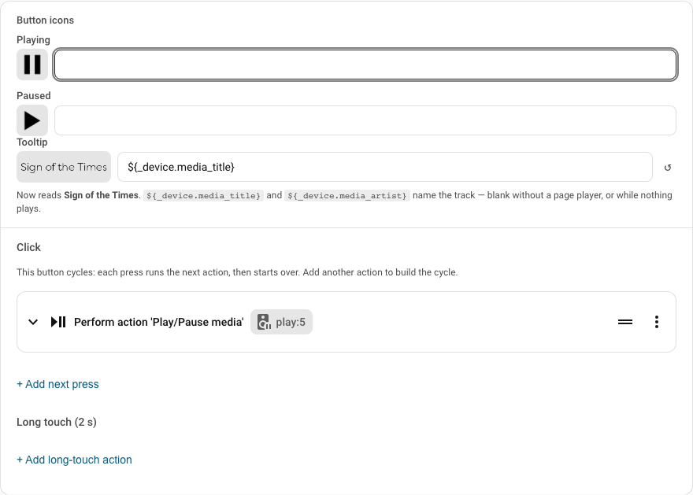

Values stay current (updated within ~2 seconds of a change), missing values are left
out rather than shown as an error, and units are only included in plain text — not
inside an icon name, since `mdi:battery-80 %` isn't a valid icon.

### Using a variable to generate an icon

Every icon field reads variables the same way — the button's **Image**, its per-state
**Button icons**, and the icons of an action (its own icon and one per state, edited in
the action editor). The hint line under each field shows what it reads right now. A
variable with no value never leaves a broken icon: a per-state icon falls back to the
action's icon for that state, and that in turn to the icon the action would show anyway.

A variable can sit inside an **Image** field, not just a tooltip — `${sensor.x}` as the
whole Image makes the button draw that value as a picture, and `${sensor.x}` inside an
`mdi:` name picks a different icon depending on the value. The catch: an icon name has
to match an existing icon *exactly*. Battery icons, for example, only exist in steps of
ten (`mdi:battery-10` … `mdi:battery-90`, plus `mdi:battery` for full and
`mdi:battery-outline` for empty), while a battery sensor reports every percent — so
`mdi:battery-${sensor.…_battery}` would ask for `mdi:battery-87`, which doesn't exist
and falls back to a blank icon.

The fix is a small Home Assistant **template helper**: an entity whose whole job is to
turn a raw value into the icon name you actually want, which the button's Image field
then just references.

1. In Home Assistant open **Settings → Devices & services → Helpers → Create helper →
   Template → Template a sensor**.
2. **Name:** `lizaIP battery icon` — this creates the entity `sensor.lizaip_battery_icon`.
3. **State template** — replace `sensor.lizaip_1c63499a7193_battery` with your remote's
   own battery sensor:

   ```jinja
   
   android
   battery
   battery-outline
   battery-{{ ((b / 10) | round(0) | int) * 10 }}
   
   ```

   Leave unit, device class and state class empty. The preview at the bottom of the
   dialog should show something like `battery-80`. A sensor with no value names
   `android` instead, so a missing reading shows a placeholder rather than a blank.
4. **Submit**, then in the lizaIP editor set the button's **Image** (or a page title) to

   ```
   mdi:${sensor.lizaip_battery_icon}
   ```

   The helper returns the name only, so `mdi:` goes in front of it. (A helper that
   returns the whole `mdi:battery-80` works too — then write
   `${sensor.lizaip_battery_icon}` on its own.) Add a tooltip such as
   `Battery ${sensor.lizaip_1c63499a7193_battery}` alongside it for the exact number.

If you prefer YAML, the same helper in `configuration.yaml` — this version also shows a
charging icon while the remote sits in its charger:

```yaml
template:
  - sensor:
      - name: "lizaIP battery icon"
        availability: "{{ has_value('sensor.lizaip_1c63499a7193_battery') }}"
        state: >
          
          
          
          {{ icon ~ ('-100' if charging else '') }}
          {{ icon }}-outline
          {{ icon }}-{{ [[(b + 5) // 10 * 10, 10] | max, 90] | min }}
          
```

#### Template: Wi-Fi signal icon

Wi-Fi icons come in four bars (`mdi:wifi-strength-1` … `mdi:wifi-strength-4`), plus
`mdi:wifi-strength-outline` for no bars and `mdi:wifi-strength-off-outline` when the
device is offline. A signal sensor (ESPHome's *WiFi Signal*, a router's per-client
sensor, …) reports dBm — a negative number, closer to 0 is better — so the helper maps
it onto bars. Replace `sensor.living_room_wifi_signal` with your own sensor:

```jinja

mdi:wifi-strength-off-outline

  
  mdi:wifi-strength-4
  mdi:wifi-strength-3
  mdi:wifi-strength-2
  mdi:wifi-strength-1
  mdi:wifi-strength-outline
  

```

Name the helper e.g. `lizaIP wifi icon` (entity `sensor.lizaip_wifi_icon`) and set the
button's **Image** to `${sensor.lizaip_wifi_icon}`; a tooltip of
`${sensor.living_room_wifi_signal}` adds the exact reading.

If your sensor reports signal **quality in %** instead of dBm, replace the inner
`if` block with:

```jinja
  
  mdi:wifi-strength-4
  mdi:wifi-strength-3
  mdi:wifi-strength-2
  mdi:wifi-strength-1
  mdi:wifi-strength-outline
  
```

As YAML in `configuration.yaml`:

```yaml
template:
  - sensor:
      - name: "lizaIP wifi icon"
        state: >
          
          mdi:wifi-strength-off-outline
          
            
            mdi:wifi-strength-4
            mdi:wifi-strength-3
            mdi:wifi-strength-2
            mdi:wifi-strength-1
            mdi:wifi-strength-outline
            
          
```

#### Weather: no template needed

A `weather.*` entity is understood directly. Its state is a condition code such as
`partlycloudy`, so lizaIP translates it for you:

| Where the variable sits | `${weather.home}` becomes |
|---|---|
| Image, on its own: `${weather.home}` | `mdi:weather-partly-cloudy` — the condition's icon |
| Image, after `mdi:` or `mdi:weather-` | the same icon (`mdi:weather-${weather.home}` works for every condition, `clear-night` included) |
| Tooltip, page title text, `text:` image | `Partly cloudy` — the condition as Home Assistant names it, in your language |
| An attribute, e.g. `${weather.home.temperature}` | the value as stored (`18`) |

`exceptional` is drawn as `mdi:weather-cloudy-alert`. A condition lizaIP doesn't know
is shown as-is.

#### Template: weather icon with night variants

Only if you want more than the built-in mapping — e.g. a moon instead of a sun after
sunset, or your own icon choices — use a template helper. It looks the condition up
and swaps in the night variants once the sun has set. Replace `weather.home` with your
own weather entity:

```jinja
{% set icons = {
  'clear-night': 'weather-night',
  'cloudy': 'weather-cloudy',
  'exceptional': 'weather-cloudy-alert',
  'fog': 'weather-fog',
  'hail': 'weather-hail',
  'lightning': 'weather-lightning',
  'lightning-rainy': 'weather-lightning-rainy',
  'partlycloudy': 'weather-partly-cloudy',
  'pouring': 'weather-pouring',
  'rainy': 'weather-rainy',
  'snowy': 'weather-snowy',
  'snowy-rainy': 'weather-snowy-rainy',
  'sunny': 'weather-sunny',
  'windy': 'weather-windy',
  'windy-variant': 'weather-windy-variant',
} %}



mdi:weather-night-partly-cloudy
mdi:{{ icons.get(c, 'weather-cloudy-alert') }}

```

`mdi:weather-cloudy-alert` stands in when the entity is unavailable or reports a
condition the table doesn't know. Name the helper e.g. `lizaIP weather icon`
(entity `sensor.lizaip_weather_icon`) and use it like the others:

| Field | You write | The remote shows |
|---|---|---|
| Image | `${sensor.lizaip_weather_icon}` | the current weather as an icon, a moon at night |
| Tooltip | `${weather.home.temperature}°` | 18° |
| Page title | `${sensor.lizaip_weather_icon}` | the weather icon as the page's title |

As YAML in `configuration.yaml`, paste the same template under `state: >`:

```yaml
template:
  - sensor:
      - name: "lizaIP weather icon"
        state: >
          {% set icons = {'clear-night': 'weather-night', 'cloudy': 'weather-cloudy',
             'exceptional': 'weather-cloudy-alert', 'fog': 'weather-fog',
             'hail': 'weather-hail', 'lightning': 'weather-lightning',
             'lightning-rainy': 'weather-lightning-rainy',
             'partlycloudy': 'weather-partly-cloudy', 'pouring': 'weather-pouring',
             'rainy': 'weather-rainy', 'snowy': 'weather-snowy',
             'snowy-rainy': 'weather-snowy-rainy', 'sunny': 'weather-sunny',
             'windy': 'weather-windy', 'windy-variant': 'weather-windy-variant'} %}
          
          
          
          mdi:weather-night-partly-cloudy
          mdi:{{ icons.get(c, 'weather-cloudy-alert') }}
          
```

The same pattern — a template helper that maps a raw state to the nearest valid icon
name — works for anything with stepped icons:

| Source value | Stepped icon names | Helper maps … |
|---|---|---|
| Battery % | `mdi:battery-10` … `-90`, `mdi:battery`, `mdi:battery-outline` | percent → nearest ten |
| Wi-Fi signal | `mdi:wifi-strength-outline`, `-1` … `-4`, `mdi:wifi-strength-off-outline` | dBm or % → 0–4 bars ([template](#template-wi-fi-signal-icon)) |
| Weather state | `mdi:weather-sunny`, `mdi:weather-rainy`, `mdi:weather-partly-cloudy`, … | built in: `${weather.home}` alone is its icon ([details](#weather-no-template-needed)); a helper only for night variants ([template](#template-weather-icon-with-night-variants)) |

This same technique — more detail, plus the full battery walkthrough — is also in
[*An icon that follows a value — the battery level*](https://github.com/liza-home/home-assistant/blob/main/README.md#an-icon-that-follows-a-value--the-battery-level)
in the README.
